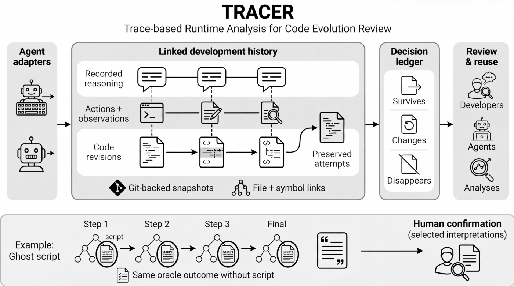

<div align="center">

# TRACER & Ghost-Code Analysis

**Keep the story behind the code. Understand what an agent leaves behind.**

Trace-based Runtime Analysis for Code Evolution Review

[Quick start](#quick-start) · [TRACER](#what-is-tracer) · [Ghost-code analysis](#what-is-ghost-code-analysis) · [Research](#research-and-reproducibility)

Python 3.10+ · Apache-2.0 · Research prototype

</div>

Coding agents leave more than a final patch: intermediate implementations,
editing scripts, commands, observations, and explanations. This repository
provides tools to preserve that history and examine the artifacts that survive.

**TRACER records and connects development history. Ghost-code analysis is one
application of that history.** You can use either component independently.



*The upper panel shows the broader TRACER architecture. The lower panel shows
the ghost-script case study, including separate deletion evidence and human
review of selected interpretations.*

## Choose your starting point

| I want to… | Start here | What I get |
|---|---|---|
| Understand a code change and its earlier attempts | [TRACER](tracer/README.md) | Recorded steps, file and symbol history, and a decision ledger |
| Inspect a leftover Python editing script | [Ghost-code analysis](ghost_analysis/README.md) | Possible source-writing behavior and inspectable AST evidence |
| Follow a helper through a recorded session | [Ghost-code analysis](ghost_analysis/README.md) | Invocation and target-change associations; embedded implementation comparisons |
| Capture mini-SWE-agent workspace changes | [Recording connector](connectors/mini_swe_agent/README.md) | Actions, model records, and before/after workspace snapshots |
| Understand or reproduce the study | [Research guide](docs/research/README.md) | Evidence stages, reported results, and external-data requirements |

## Quick start

Use **Python 3.10+**. The analysis demo uses only the Python standard library;
the TRACER demo also needs **Git**. Neither demo needs an API key, Docker, a GPU,
or the study archives. Run the commands below from the repository root.

```sh
git clone https://github.com/pkrajput/ghost_code_artifact.git
cd ghost_code_artifact
```

### 1. Try ghost-script analysis

```sh
python3 -m ghost_analysis demo --out outputs/ghost-demo
```

The demo builds a small synthetic development history and runs the analysis.
It demonstrates the difference between a script that can write source and a
helper whose use is corroborated by recorded changes. The example is synthetic;
it is not a reproduction of the paper's results.

```text
Static candidates: 2; history-supported helpers: 1.
Task redundancy: unknown for every file. The demo includes no deletion evidence.
```

Inspect the reports in `outputs/ghost-demo/`. Use a fresh output directory when
rerunning the demo.

For your own Python script:

```sh
python3 -m ghost_analysis scan ghost_analysis/examples/writer.py
```

Replace the example path with your own script or directory. This inspects source
without executing the script. A scan can identify a
**candidate**; history and deletion evidence answer different questions.
See the [analysis guide](ghost_analysis/README.md) for output fields, supported
patterns, and archive-based analysis.

### 2. Try TRACER

```sh
python3 -m venv .venv
. .venv/bin/activate
python -m pip install -e ./tracer
python tracer/examples/quickstart.py
```

The example creates an isolated temporary Git repository, records an initial
attempt and a revision, and prints their history and decision ledger. It also
prints the example repository path so you can continue exploring it.

```sh
codegraph-trace --help
```

`codegraph-trace` is the recorder's command name; `codegraph_trace` is its Python
package name. The [TRACER guide](tracer/README.md) covers recording your own
session, querying history, and optional integrations.

## What is TRACER?

**TRACER is the development-history infrastructure.** It connects a recorded
action and its available explanation to the code versions around that action.
Its core supports:

- **Step recording:** preserve prompts, supplied reasoning, actions, and observations.
- **Version history:** retain intermediate attempts using Git-backed snapshots.
- **File and symbol links:** connect changes to the code they affect.
- **A decision ledger:** derive whether introduced code survives, changes, or disappears.
- **Review and querying:** inspect earlier versions and the context recorded with them.

The ledger describes code evolution. Its labels are not correctness judgments.
Recorded explanations retain their source; TRACER does not infer unavailable
reasoning or treat an agent's explanation as proof of intent.

The core includes an OpenHands adapter and manual recording interfaces. The
mini-SWE-agent [study connector](connectors/mini_swe_agent/README.md) captures
Git-anchored workspace snapshots in its own archive format. That connector
supports the analysis in this repository; its outputs are not automatically
imported into the core decision ledger.

## What is ghost-code analysis?

**This release studies retained Python source-writing helpers, called ghost
scripts when separate task-oracle evidence establishes redundancy.** An agent
might create `patch.py` to rewrite a product module, execute it, refine the
product further, and leave `patch.py` in the final workspace. The helper can
preserve either the final implementation or an earlier attempt.

The analysis separates three questions:

| Question | Evidence | What it establishes |
|---|---|---|
| Could this helper write Python source? | Bounded AST analysis | A source-writing candidate |
| Was the helper used during construction? | Invocation, helper version, and target changes in recorded actions | A history-supported construction association |
| Is it redundant for this completed task? | Valid, complete outcomes before and after deletion under the same fixed oracle | Task-level redundancy |

A further analysis parses definitions embedded in string literals and compares
them with product revisions. It distinguishes **current**, **superseded**, and
**unlinked** implementations. “Unlinked” means no complete correspondence was
established; it does not mean useless.

The operational definition of a ghost script is:

```text
outcome(fixed_oracle, final_workspace without helper)
    == outcome(fixed_oracle, final_workspace)
```

Both evaluations must be valid, complete, and passing under the same fixed
oracle. A helper may have been useful
during development and still be redundant at the endpoint. Passing these checks
does not establish its value for future tasks.

The static commands inspect evidence and produce reports. They do not delete
files or execute captured helpers. Static findings alone do not establish
task-level redundancy.

## Repository map

```text
ghost_code_artifact/
├── tracer/                       TRACER recorder, CLI, integrations, and demo
├── ghost_analysis/               AST/history analysis, demo, and study scripts
├── connectors/mini_swe_agent/     Study recording connector and capture format
└── docs/
    ├── assets/                   Architecture figure
    └── research/                 Study scope and reproduction requirements
```

## Research and reproducibility

This repository accompanies the working manuscript **Development Histories as
Software Evidence**. The study analyzes recorded mini-SWE-agent trajectories
on SWE-bench and uses saved deletion results to establish task-level redundancy.

| Reported study result | Count |
|---|---:|
| Reconstructable endpoints with matching passing outcomes | 88 |
| Retained Python file occurrences screened | 1,662 |
| AST source-writing candidates | 65 |
| History-supported helpers | 62 across 40 runs |
| Helpers with a linked embedded implementation | 25 |
| Linked implementations matching final code / superseded | 20 / 5 |

Recovery of all 62 reference helpers is a **retrospective check within the study
cohort**, not a held-out accuracy estimate. The manuscript remains under revision.

The source release includes runnable demos and analysis code. Full study
reproduction also requires the recorded trajectory archive, inventories, and
saved oracle evidence; those large research inputs are **not bundled here**.
See the [research guide](docs/research/README.md) for the exact separation between
trying the tool, rerunning analyses, and rerunning subject evaluations.

## Limitations

The AST analysis targets supported Python editing patterns and the files that
were captured. Dynamic paths, unsupported constructs, and missing snapshots can
leave evidence unresolved. Multiple operations in one action limit causal
attribution. Review the reported source and history before drawing conclusions.

Broader evaluation, additional adapters, and history-informed cleanup are
research directions. This release provides recording and analysis tools;
automated safe removal is not a demonstrated capability.

## Contributing and attribution

Bug reports are most useful with a small synthetic script or recording that
shows the problem. See [CONTRIBUTING.md](CONTRIBUTING.md) for development checks.
Please avoid including credentials or private session content in reports.

TRACER builds on structural-indexing ideas and integration with
`codebase-memory-mcp`; the capture connector integrates with mini-SWE-agent.
See [THIRD_PARTY_NOTICES.md](THIRD_PARTY_NOTICES.md) for source provenance and
attribution. This project is licensed under [Apache-2.0](LICENSE). Paper citation
metadata will be added when finalized.
